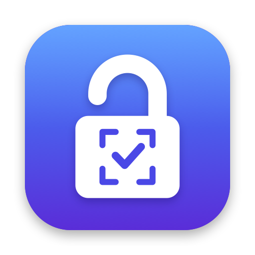

# MacNearUnlock

Approve access to your **already logged-in, locked** Mac from your nearby iPhone with a real Face ID match. It is built honestly around what Apple's public APIs allow.

*Built with AI assistance (Claude).*

* **MacNearUnlockMac**: macOS menu bar app (Mac mini friendly: no camera, notch or Touch ID needed).
* **MacNearUnlockiOS**: iPhone companion. Every approval is a Secure Enclave signature that the Secure Enclave only produces after a fresh Face ID match.
* **MacNearUnlockShared**: Swift package with the versioned protocol, canonical signing bytes, verification, pairing, TLS-PSK transport and the Mac/iPhone protocol engines. 82 tests.

> **What this is not.** There is no public API that lets a third-party app satisfy the macOS login window with an iPhone's Face ID. Out of the box MacNearUnlock runs in **authentication-only mode**: it proves, end to end, that *your* iPhone approved *this* request for *this* Mac and *this* account with Face ID, and then stops. An **experimental, off-by-default** adapter can type a locally stored Mac password into the lock screen after a verified approval (the technique [Glance](https://github.com/jonnyoo/glance) uses). It is not native login integration, it has not been validated on a real lock screen yet, and your Mac password always remains the normal way in. It never works after a restart, logout or at the FileVault pre-boot screen.

## How it works

```
 iPhone (foreground app)                         Mac mini (menu bar app, logged-in user session)
 ───────────────────────                         ─────────────────────────────────────────────────
 Secure Enclave P-256 key                         Secure Enclave P-256 identity key
 (.biometryCurrentSet, per Mac)                   (no user presence: must sign while locked)
           │                                                     │
           │  TLS 1.2 ECDHE-PSK-CHACHA20-POLY1305, PSK = per-pairing 256-bit key
           │  + HMAC binder over the TLS exporter (proves *which* pairing)
           ├─────────────── clientHello / serverHello ───────────┤
 tap "Request Unlock" ─────────────── initiate ────────────────► │ CGSession: locked? right user? on console?
           │ ◄────────── unlockRequest (Mac-signed) ──────────── │ 256-bit nonce, requestID, macID, username,
 verify Mac signature against pinned key                         │ pairingID, deviceID, action, expiry
 show request → tap "Approve with Face ID"                       │
 Secure Enclave signs canonical bytes ─── approval ────────────► │ rebuild bytes from OWN copy, verify signature,
           │                                                     │ monotonic + wall expiry, replay, session re-check
           │ ◄──────────────────── result ────────────────────── │ consume once → authentication-only: report
                                                                 │              → experimental adapter (if enabled)
```

Pairing uses a QR code (or a 16-character code) shown on the Mac, a one-time TLS-PSK tunnel keyed by that code, an X25519 exchange, transcript signatures from both long-term keys, the QR's Mac-key fingerprint, and a 6-digit + 4-word verification code you compare on both screens before confirming with Face ID. Details: [docs/PROTOCOL.md](docs/PROTOCOL.md).

## Status

| Area | Status |
| --- | --- |
| Protocol, canonical encoding, signing/verification, replay/expiry/wrong-device/revocation checks, state machine, rate limits | **Implemented and unit-tested** (`swift test`, `xcodebuild test` on macOS and the iOS 27.2 Simulator) |
| Pairing handshake (QR fingerprint pinning, SAS, transcript signatures, burn after wrong codes) | **Implemented; loopback-tested over real TLS** with software keys |
| Session protocol over TLS-PSK + exporter binding (auth-only, forged Mac, unpaired device, binder forgery, replay, lost connection, sleep/unlock invalidation, revocation both ways) | **Implemented; loopback-tested over real TLS** |
| Mac menu bar app (settings, pairing window, pill, launch at login, session monitoring) | **Implemented, builds without warnings, smoke-launched** (signed with an Apple Development identity). Not exercised against a physical iPhone. |
| iPhone app (Secure Enclave + Face ID signer, QR scanning, Bonjour, approvals) | **Implemented, builds for Simulator and device (unsigned)**. Needs a physical Face ID iPhone and provisioning; see [docs/SETUP.md](docs/SETUP.md). |
| Lock on departure | Implemented, **off**, cannot be enabled until a manual test lock succeeds. Not proximity. |
| Experimental lock-screen credential entry | Implemented behind a compile flag + runtime gates, **off, not validated**; see [docs/EXPERIMENTAL_ADAPTER.md](docs/EXPERIMENTAL_ADAPTER.md) |
| Native macOS login authorization by iPhone Face ID; Face ID while the iPhone app is backgrounded; UI over the lock screen; anything after restart/logout/pre-boot | **Not possible with public APIs** (and the last one is deliberately refused) |

Full results and the hardware test plan: [docs/TESTING.md](docs/TESTING.md).

## Quick start

Requirements: Xcode 27.2 or newer (built and tested with Xcode 27.2 / Swift 6.4.2 on macOS 27.0.1). Deployment targets: **macOS 14.0**, **iOS 17.0**.

```bash
cd MacNearUnlockShared && swift test
```

```bash
xcodebuild -project MacNearUnlock.xcodeproj -scheme MacNearUnlockMac -destination 'platform=macOS' build
```

```bash
xcodebuild -project MacNearUnlock.xcodeproj -scheme MacNearUnlockiOS -destination 'generic/platform=iOS Simulator' build
```

Signing, installing on your iPhone, pairing and the first authentication test: **[docs/SETUP.md](docs/SETUP.md)**.

## Repository layout

```
MacNearUnlock.xcodeproj        Xcode project (two app targets + local package)
Config/                        Base.xcconfig, Local.xcconfig.example, partial Info.plists
MacNearUnlockShared/           Swift package: Core, Crypto, Protocol, Pairing, Transport, Engine + Tests
MacNearUnlockMac/              App, Engine (identity, devices, settings, session monitor, departure lock),
                               UI (menu bar, settings, pairing, pill), Experimental (adapter, vault, injector)
MacNearUnlockiOS/              App (model, Bonjour), Security (Face ID signer, pairing store), UI, Pairing
docs/                          SETUP, PROTOCOL, TESTING, GLANCE_ANALYSIS, EXPERIMENTAL_ADAPTER
SECURITY.md                    Threat model and security policy
```

## Credits

Lock-state detection and the keystroke technique were studied in [Glance](https://github.com/jonnyoo/glance) by Jonathan Zhou (MIT). `MacNearUnlockMac/Experimental/KeystrokeInjector.swift` is adapted from it; see [THIRD_PARTY_NOTICES.md](THIRD_PARTY_NOTICES.md) and [docs/GLANCE_ANALYSIS.md](docs/GLANCE_ANALYSIS.md). No third-party dependencies.
